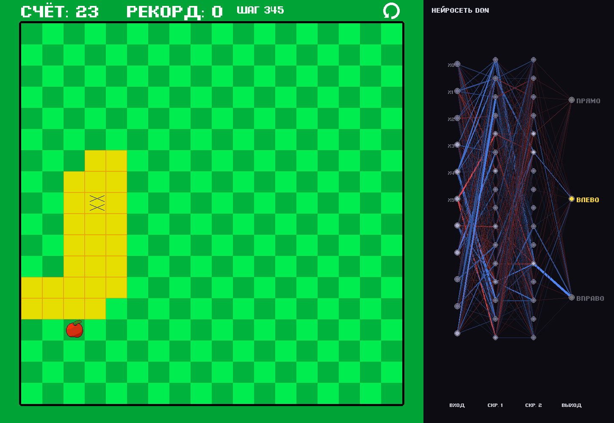

# 🐍 Змейка с ИИ (обучение с подкреплением)

Два проекта в одной папке:

* **`game_snake.py`** — классическая «Змейка» на PyGame (та самая, из репозитория `Game-Snake`): собираешь яблоки, растёт длина, рекорд сохраняется в файл `record`.
* **`snake_ai/`** — ИИ-агент, который учится играть сам методом **DQN** (глубокое обучение с подкреплением) и потом играет без человека.

Агент видит только цифры состояния (направление, где яблоко, куда опасно поворачивать) и каждый тик выбирает одно из трёх действий: **продолжать движение / повернуть влево / повернуть вправо**. Постепенно, методом проб и ошибок, он учится собирать яблоки и не врезаться в стены и себя.

В режиме просмотра справа от поля показывается **нейросеть в реальном времени**: нейроны, связи с весами и подсветка проходящих сигналов.



---

## 🚀 Быстрый старт

```bash
cd ~/PyCharmProjects/Snake-AI
python3 -m venv .venv
source .venv/bin/activate
pip install -r requirements.txt
```

### 1. Поиграть руками (оригинальная игра)

```bash
python game_snake.py
```
Управление: **W A S D**, кнопка **Replay** — новая игра.

### 2. Обучить ИИ

```bash
python train.py                    # 4000 эпизодов, векторное состояние
python train.py --episodes 8000    # дольше — точнее
python train.py --state vector24   # расширенное состояние (24 признака)
python train.py --state grid       # карты 18×18
```

В репозитории уже лежит обученная модель `models/best_vector.pt` (~31 очко в среднем) — можно сразу запускать `play.py`.

Во время обучения в консоль печатается средний счёт, средняя награда, ε (доля случайных ходов) и loss. Раз в `--eval-every` эпизодов агент играет «всерьёз», без случайных движений, и если результат лучше прежнего — модель сохраняется в `models/best_<state>.pt`. График обучения кладётся в `training_<state>.png`, история — в `training_history_<state>.csv`.

### 3. Посмотреть, как играет обученный ИИ

```bash
python play.py                                  # модель по умолчанию + панель нейросети
python play.py --model models/best_vector.pt --speed 60
python play.py --episodes 0                     # играть бесконечно, до закрытия окна
python play.py --human                          # играть самому (WASD / стрелки)
python play.py --no-network                     # без панели сети (узкое окно)
```

В окне видно счёт, рекорд, номер шага и живую работу сети. После каждой партии — клик мышью или Enter, чтобы начать следующую. В режиме `--human` клавиши **W A S D** и стрелки поворачивают змейку, разворот на 180° запрещён.

---

## 🧠 Как устроен агент

| Файл | Что делает |
|------|------------|
| `snake_ai/game.py` | Игровая логика без графики: поле 18×18, змейка, яблоки, столкновения, награда |
| `snake_ai/state.py` | Кодировщики состояния: `vector` (11 признаков) и `grid` (карты 18×18) |
| `snake_ai/agent.py` | DQN: сеть, буфер повторений, ε-жадная стратегия, целевая сеть, активации для визуализации |
| `snake_ai/render.py` | Отрисовка игры и панели нейросети в pygame |
| `train.py` | Цикл обучения, логи, проверка, график |
| `play.py` | Просмотр игры агента или игра человека с клавиатуры |

### Состояние (вектор, 11 признаков)

Относительно головы змейки:

1–4. текущее направление движения (one-hot: вверх / вправо / вниз / влево);
5–7. опасно ли двигаться **прямо / влево / вправо** (стена или собственное тело);
8–11. где находится яблоко — слева / справа / сверху / снизу.

Вариант `vector24` добавляет к ним 8 клеток вокруг головы, длину змейки и расстояния до стен — «тактическое зрение» для узких проходов, но требует более долгого обучения. Вариант `grid` подаёт сети три бинарные карты 18×18 (тело, голова, яблоко) и one-hot направления.

### Действия

`0` — не менять направление, `1` — повернуть влево, `2` — повернуть вправо.
Разворот на 180° недоступен (как и живой змейке), поэтому агент физически не может «выстрелить себе в хвост».

### Награда

| Событие | Награда |
|---------|---------|
| съел яблоко | `+10` |
| столкновение со стеной или телом | `-10` |
| обычный шаг | `-0.005` |
| приблизился к яблоку | `+0.3` за клетку |
| заполнил всё поле | `+100` |
| долго не ест (зациклился) | `-2` и партия завершается |

Поощрение за сокращение расстояния до яблока заметно ускоряет обучение, а защита от зацикливания не даёт агенту бесконечно кружить по безопасному маршруту.

### Алгоритм

DQN (Deep Q-Network) с улучшениями:

* **Double DQN** — действие выбирает онлайн-сеть, а оценку даёт целевая, это снижает переоценку;
* **буфер повторений** на 100 000 переходов — агент учится на случайных мини-батчах из прошлого опыта;
* **целевая сеть** синхронизируется раз в 2000 обновлений;
* **ε-жадная стратегия** плавно снижается с 1.0 до 0.05, чтобы агент дольше исследовал игру.

Гиперпараметры по умолчанию: `lr=1e-3`, `gamma=0.97`, `batch=256`, `hidden=128`, `train_every=4`. Всё меняется флагами командной строки (см. `python train.py --help`).

### Почему раньше агент умирал на 30–40 очках

Причины были две, и обе исправлены:

1. **Лимит шагов на партию** был 400. Змейка длиной 35 физически не успевала собрать больше яблок за отведённые тики. Теперь лимит 2000.
2. **Зацикливание.** Агент находил безопасный маршрут по кругу, не рисковал и доживал до конца партии с нулём новых яблок. Теперь, если яблоко не съедено слишком долго (с запасом на длину змейки), партия прерывается со штрафом.

Дополнительно: ε теперь убывает медленнее (0.9998 за эпизод), поэтому агент дольше продолжает пробовать новые пути, а не застревает в первой найденной стратегии.

---

## 🖥 Визуализация нейросети

В окне `play.py` справа от игрового поля — чёрная панель:

* **вход (11)** — значения признаков состояния: яркость нейрона показывает величину признака;
* **скрытый 1** и **скрытый 2** — по 16 нейронов (первые из 128): яркость — активация после ReLU;
* **выход (3)** — оценки трёх действий, выбранное подсвечивается жёлтым и подписью;
* **связи** — веса: красные — положительные, синие — отрицательные, толщина — величина веса, а яркость зависит ещё и от активации нейрона-источника, поэтому видно, какие связи реально передают сигнал в этом кадре.

Сигнал в текущем кадре считается тем же проходом, что и выбор действия, поэтому подсветка соответствует именно этому ходу.

---

## 📊 Что получается

На старте агент играет случайно и в среднем не собирает ни одного яблока. После исправлений (лимит шагов, защита от зацикливания, дообучение с `gamma=0.99`) он перестаёт упираться в 30–40 очков:

| Версия | Средний счёт (100 игр) | Медиана | Лучший | Доля игр 40+ |
|--------|------------------------|---------|--------|--------------|
| случайные ходы | ~0.1 | 0 | 2 | 0% |
| после 4000 эпизодов | ~26 | 26 | 34 | 0% |
| после 8000 эпизодов | ~29 | 30 | 83* | 14% |
| после дообучения (16000) | **~31** | **29–32** | **59** | **~20%** |

\* редкий «счастливый» эпизод на 83 яблока — агент иногда находит длинный безопасный маршрут.

Потолок 30–40 больше не жёсткий: примерно каждая пятая партия заканчивается с 40+ яблоками, а распределение по 100 играм выглядит так — 10–20 очков: ~10%, 20–30: ~30%, 30–40: ~40%, 40–50: ~18%, 50+: ~2%.

Точные цифры зависят от железа и флагов запуска; смотрите `training_<state>.png` и `training_history_<state>.csv`.

---

## 📋 Замечания

* Используется `pygame-ce` (Community Edition) — она поддерживает Python 3.14, в отличие от классического `pygame`.
* Оконный режим требует дисплея; для тестов есть headless-рендер (`Renderer(headless=True)`).
* Модели в `models/*.pt` и файлы обучения в `.gitignore` — репозиторий не пухнет от бинарников.
* Старые модели, обученные с `hidden=256`, не совместимы с новой сетью `hidden=128` — переобучите агента (`python train.py`).